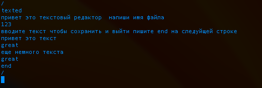
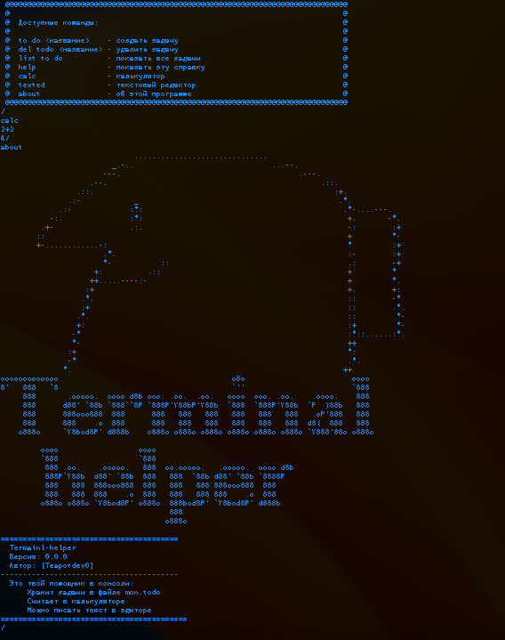

# Terminal-helper
# Версия: 0.0.0
# Автор: [Teapotdev0]

* `Это твой помощник в консоли`
* `Считает в калькуляторе`

## to do

* `Хранит задачи в файле mon.todo`

## texted

* `Можно писать текст в редакторе`

## about

* `about`
